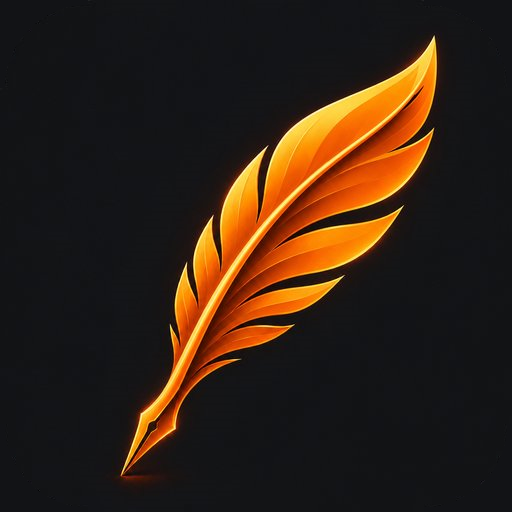
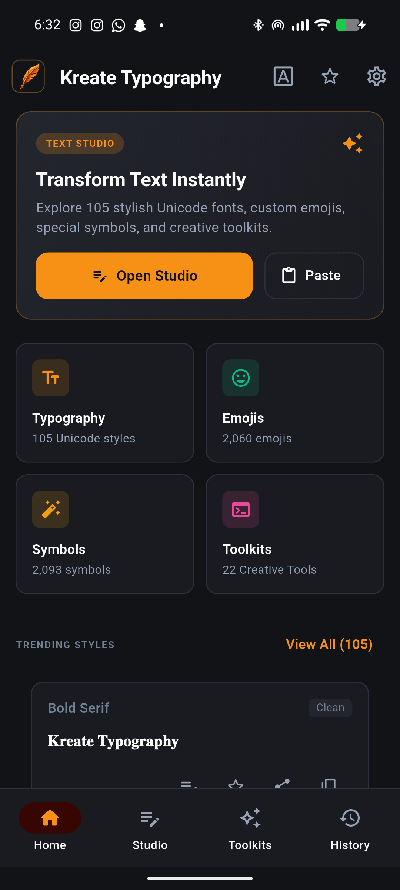
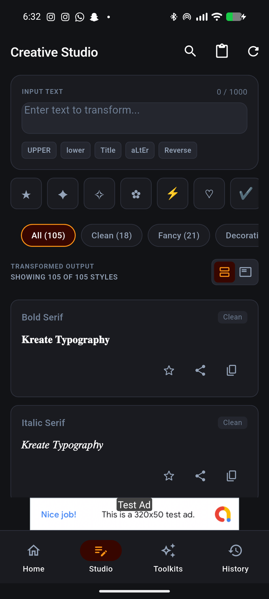
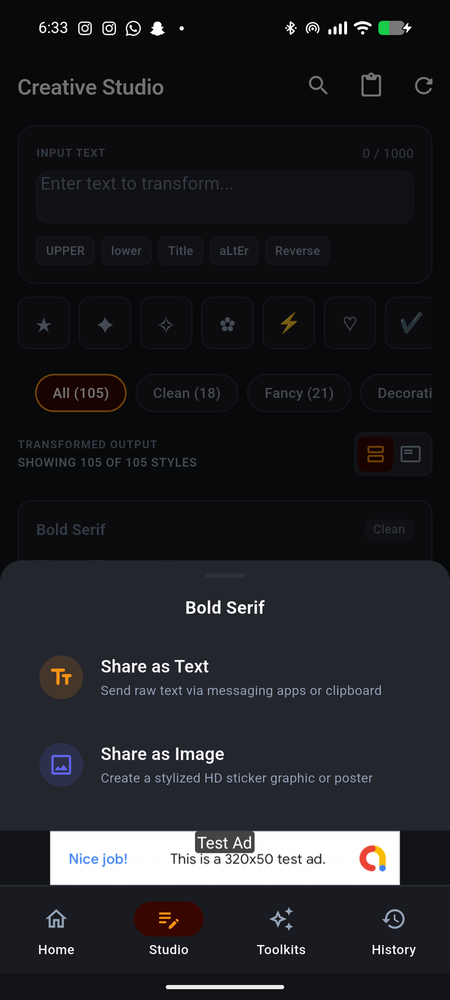
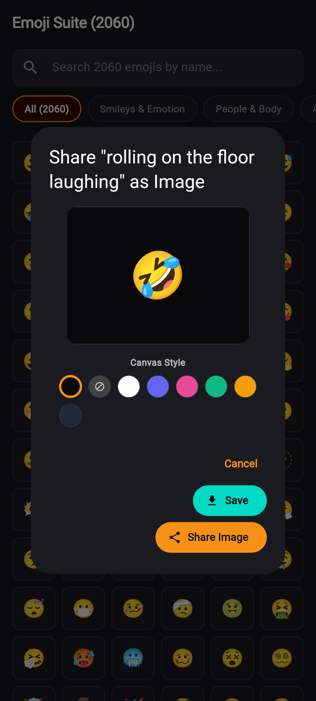
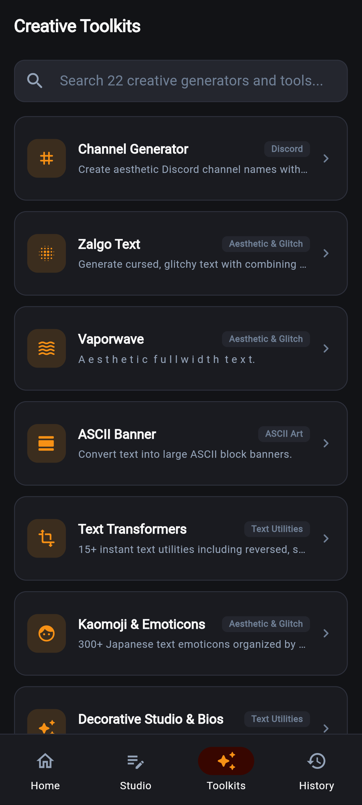
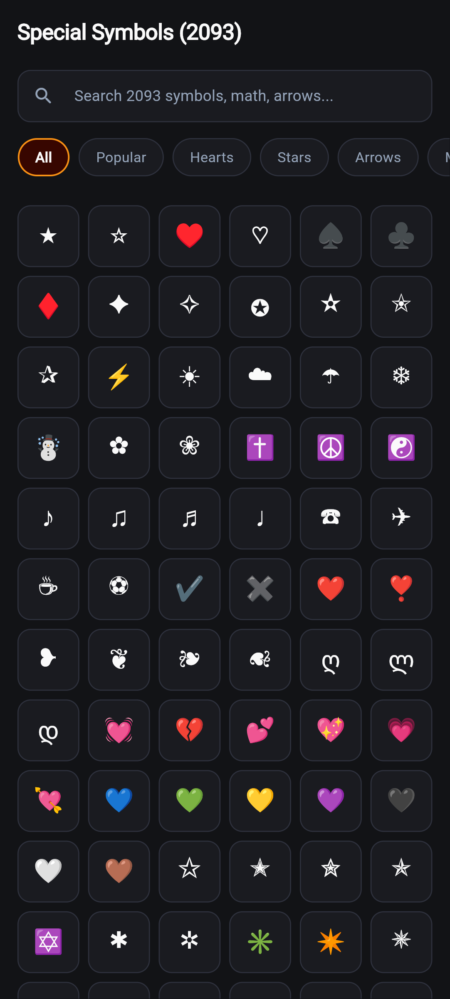
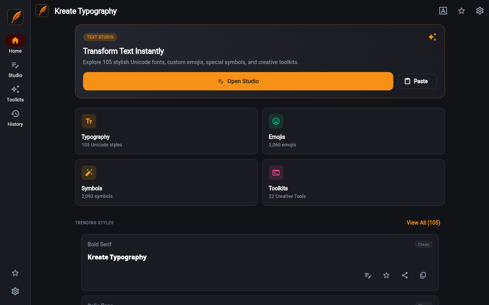

  
  <h1>Kreate Typography</h1>
  
<strong>Premium Unicode Typography Engine, Creative Canvas & 22 Text Toolkits</strong>

  
<em>Crafted with precision by <strong>Muhammad Abdul Rafay</strong> • Powered by <strong>KreateKode</strong></em>

  

    
    
    
  

  

    
    
    
    
    
  

---

## 🔗 Official Links & Resources

- 📱 **Google Play Store:** [Download on Google Play](https://play.google.com/store/apps/details?id=com.kreatekode.kreate_typography)
- 🌐 **Desktop Web Workstation:** [kreatekode.website/kreatetypography/webapp](https://kreatekode.website/kreatetypography/webapp)
- 🏢 **Product Website:** [kreatekode.website/kreatetypography](https://kreatekode.website/kreatetypography)
- 👨‍💻 **Lead Developer:** [Muhammad Abdul Rafay (@rafayshhh)](https://github.com/rafayshhh)

---

## 📖 Overview

**Kreate Typography 2.0** is an expansive, ground-up creative typography workstation designed for content creators, gamers, Discord power users, and designers. Styled with the bespoke **Golden Quill aesthetic** (Deep Obsidian Charcoal paired with Radiant Amber Gold), it transforms standard text into **105 high-fidelity Unicode styles**, hosts **22 creative text generators**, browses **4,000+ offline emojis and symbols**, and renders **100% watermark-free HD sticker cards** with zero layout lag.

---

## 📸 Visual Showcase

### Mobile Application (Verified on Google Pixel 8)

| 🏠 Home Dashboard | 🔤 105-Style Text Studio |
|:---:|:---:|
|  |  |

| 🚀 Universal Share Options | 🖼️ Watermark-Free Sticker Export |
|:---:|:---:|
|  |  |

| 🛠️ 22 Creative Toolkits Hub | 🔣 2,093 Special Symbols Browser |
|:---:|:---:|
|  |  |

### Desktop Web Workstation (Responsive CanvasKit Engine)

  
  
<em>Dual-column creative workstation featuring persistent side rails and real-time live preview.</em>

---

## ✨ Core Feature Highlights

### 1. 🔤 105 Unicode Mathematical Typography Styles
Pure mathematical Unicode conversion operating with zero network calls across 5 distinct categories:
- **Clean Alphabetic (18 styles):** Bold Serif, Italic Serif, Bold Italic Serif, Sans, Bold Sans, Monospace, Double-Struck, Compact Sans, Outline Sans, Math Serif.
- **Fancy Typography (21 styles):** Royal Cursive, Gothic Fraktur, Bold Fraktur, Medieval, Chancery Hand, Elven Cursive, Victorian, Renaissance.
- **Decorative Glyphs (26 styles):** Circled, Negative Circled, Squared, Small Caps, Bubble Letters, Japanese Brackets `【】`, Star Wings `★彡 彡★`, Ribbon Wings `🎀 🎀`, Crowned `👑 👑`.
- **Aesthetic Text (20 styles):** Vaporwave Fullwidth, Aesthetic Spaced, Regional Indicator, Mirror Text, Dot Matrix, Soft Aesthetic, Cute Kawaii `(◕‿◕)♡`.
- **Glitch & Transform (20 styles):** Zalgo (Mini, Normal, Max, Extreme), Strikethrough, Slash, Underline, Morse Code, Leet Speak Pro, Demonic Void, Matrix Rain.

### 2. 🎨 Interactive Creative Text Studio
- **All 105 Styles Simultaneously:** Type once and see instant, real-time transformations across every single font style simultaneously.
- **Dynamic Casing Controls:** Instant 1-tap `UPPER`, `lower`, `Title Case`, `aLtErNaTiNg`, and grapheme-safe `Reverse`.
- **Quick Symbol Strips:** Immediate 1-tap insertion of frequently used aesthetic glyphs, dividers, and stars.
- **Persistent Bookmarks:** Fast local favorites and a bounded FIFO history log.

### 3. 🖼️ Universal "Share as Image" Everywhere
- Export any typography style, toolkit output, emoji, or symbol as a clean, high-resolution sticker graphic card.
- **100% Watermark-Free:** Zero promotional text or brand watermarks on exported images.
- **Multi-Palette Swatches:** Customize canvas backgrounds with Obsidian, Transparent, White, Indigo, Pink, Amber, and Emerald themes.

### 4. 🛠️ 22 Production Creative Toolkits
Dedicated utility suite tailored for social bios, gaming handles, and developers:
1. **Discord Channel Generator:** Automates `#channel-names`, kebab-casing, and dividers.
2. **Zalgo Glitch Studio:** Customizable glitch intensity mark stacking with memory safety.
3. **Vaporwave Converter:** Full-width Japanese aesthetic typography.
4. **ASCII Banner Generator:** Multi-font ASCII text art transformer.
5. **Text Transformers Suite:** 15+ instant utilities (Upper, Lower, Title, Snake, Kebab, Camel, etc.).
6. **Kaomoji & Emoticons Studio:** 300+ Japanese emotion faces and cute animal kaomojis.
7. **Decorative Studio & Bios:** Bio templates and stylish Unicode text frames for Instagram & Discord.
8. **Canvas Kreator:** High-res poster designer with custom aspect ratios (1:1, 9:16, 16:9, 4:5).
9. **Morse Code Studio:** International Morse encoder and decoder with live dot-dash translation.
10. **Binary & Hex Codec:** Instant conversion between text, 8-bit binary bytes, and hexadecimal representation.
11. **Invisible Space Maker:** Zero-width space generator for gaming clan tags and clean bios.
12. **Text Multiplier & Repeater:** Repeat text and quotes with custom line numbering and delimiters.
13. **Upside Down & Mirror Flipper:** Real-time inverted and backwards text transformation.
14. **Small Caps & Phonetics:** Convert Latin characters into phonetic small capitals.
15. **URL Slug & SEO Sanitizer:** Convert article titles into URL-safe clean slugs.
16. **Word & Grapheme Counter:** Real-time metrics for characters, graphemes, words, and reading time.
17. **Winged Nickname Styler:** Wrap gamertags in wings, crowns, and cross symbols.
18. **NATO Phonetic Speller:** ICAO/NATO aviation phonetic alphabet transliteration.
19. **Word-to-Emoji Replacer:** Automatically replaces keywords (fire, love, star, cat) with matching emojis.
20. **Palindrome & Symmetry Checker:** Phrase verification with character symmetry breakdown.
21. **Strikethrough & Line Decorator:** Multi-layer strikethrough, cross-hatching, and decorative slashes.
22. **Cursed Void Glitch:** Dark void runic character generator with combining marks.

### 5. 📚 4,000+ Offline Unicode Catalogs
- **2,060 Unicode Emojis:** Searchable offline database covering Unicode 15/15.1/16 smileys, people, animals, objects, and symbols.
- **2,093 Unicode Symbols:** Categorized special characters (arrows, math, currency, geometric shapes, lines, brackets, music, weather, zodiac, chess, dingbats, braille, Roman numerals).

### 6. 💻 Desktop Web Workstation
- Accessible on any desktop browser at [kreatekode.website/kreatetypography/webapp](https://kreatekode.website/kreatetypography/webapp).
- **Desktop-Optimized:** Built for widescreen workstations (800px+ width) with multi-column side rails.
- **Mobile Responsive Gate:** Automatically guides mobile visitors to the native Android app for the best touch experience.

---

## 🎨 Design & Accessibility Standards

- **Golden Quill Brand Identity:**
  - **Dark Mode (Default):** Deep Obsidian Charcoal (`#0C0D12` / `#16171E`) with Radiant Amber Gold (`#F59E0B`). Primary text achieves an exceptional **19.1:1** contrast ratio (WCAG AAA).
  - **Light Mode:** Pristine Ivory Canvas (`#FBFBFA`) accented with Burnished Amber (`#B45309`), delivering an **18.7:1** contrast ratio (WCAG AAA).
- **Grapheme Safety:** Text operations use `characters` (grapheme clusters) to safely process emojis, flags, and zero-width joiners (ZWJ) without codepoint splitting.
- **Touch Targets:** All interactive icons and buttons enforce the minimum **48×48 dp** touch target constraint (WCAG 2.5.5).
- **120Hz Fluid Motion:** Staggered idle preloading and native platform view isolation eliminate frame drops and stutter on high-refresh-rate displays.

---

## 🛠️ High-Level Tech Stack

- **Framework:** Flutter 3.50 / Dart 3.14
- **Architecture:** Feature-First Clean Domain Model (Offline-First)
- **Design System:** Material 3 with Custom WCAG AAA Design Tokens
- **Target Platforms:** Android 16 (SDK 36, edge-to-edge) & Modern Desktop Web (CanvasKit)
- **Bundle Optimization:** Icon font tree-shaking (99.2% reduction down to 13.9 KB)

---

## 👨‍💻 Author & Studio

- **Lead Developer:** **Muhammad Abdul Rafay** ([GitHub Profile](https://github.com/rafayshhh))
- **Brand / Studio:** [KreateKode](https://kreatekode.website)
- **Web App:** [Kreate Typography Web](https://kreatekode.website/kreatetypography/webapp)
- **Copyright:** © 2026 Muhammad Abdul Rafay / KreateKode. All rights reserved.
